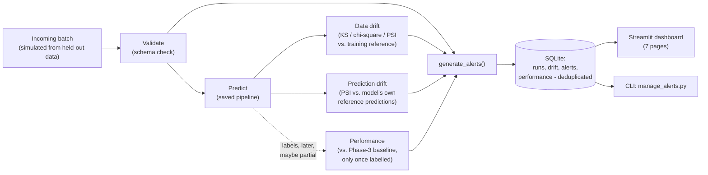

# ML Model Health Monitor

An end-to-end machine learning monitoring system: trains a classifier on
the UCI Adult Census Income dataset, then detects **data drift**,
**prediction drift**, and **model performance degradation** on simulated
incoming batches, raises deduplicated **alerts**, persists everything to
**SQLite**, and displays it all in an interactive **Streamlit + Plotly**
dashboard.

Built as a portfolio project to demonstrate production-style ML monitoring
techniques. It is **not** a production system, has not been assessed for
fairness, and must not be used to make decisions about real people — see
[Known Limitations](#known-limitations).

[](https://www.python.org/)
[](LICENSE)

There is no automated CI pipeline configured for this repository — the
"446 passed" result throughout this document is from running
`python -m pytest -q` locally (verified multiple times, including from a
clean environment, while writing this documentation), not from a
continuously-running check.

---

## Table of contents

1. [Problem statement](#problem-statement)
2. [Key features](#key-features)
3. [Technology stack](#technology-stack)
4. [Architecture overview](#architecture-overview)
5. [Project status](#project-status)
6. [Project structure](#project-structure)
7. [Dataset](#dataset)
8. [Installation](#installation)
9. [Model training](#model-training)
10. [Running the dashboard](#running-the-dashboard)
11. [Running tests](#running-tests)
12. [Example monitoring workflow](#example-monitoring-workflow)
13. [Validation and preprocessing](#validation-and-preprocessing)
14. [Detecting drift](#detecting-drift)
15. [Prediction and performance monitoring](#prediction-and-performance-monitoring)
16. [Alerts and monitoring history](#alerts-and-monitoring-history)
17. [Dashboard](#dashboard)
18. [System integration and testing](#system-integration-and-testing)
19. [Actual evaluation metrics](#actual-evaluation-metrics)
20. [Known limitations](#known-limitations)
21. [License](#license)
22. [Screenshots](#screenshots)
23. [Documentation index](#documentation-index)

---

## Problem statement

A model that scores well at training time does not stay trustworthy
forever. Once deployed, three things can go wrong independently of each
other, and a system that only watches one of them misses the other two:

1. **The input changes** (data drift) — the population arriving now looks
   statistically different from the population the model was trained on.
2. **What the model says changes** (prediction drift) — the model's own
   output distribution shifts, which can happen even when the input looks
   unchanged, or can lag/lead an input shift.
3. **The model becomes less accurate** (performance degradation) — only
   knowable once true outcomes ("ground truth") arrive, which in most real
   systems happens **later**, **separately**, and for only **some** of the
   predictions made.

This project builds a monitoring system that measures all three
independently, raises alerts with sensible severity and deduplication
instead of flooding a log, keeps a persistent history that survives a
restart, and demonstrates all of it from training through an interactive
dashboard — on a real (if dated) dataset, with every threshold measured
rather than guessed.

## Key features

- **A real, evaluated baseline model** — logistic regression with a
  deliberately tuned decision threshold, 5-fold cross-validated, compared
  against a Random Forest, with per-group fairness metrics measured (not
  corrected).
- **Schema-driven batch validation** that separates hard errors (missing
  columns, wrong types) from soft warnings (missing values, unknown
  categories, out-of-range numbers) — nothing is silently repaired.
- **Numerical and categorical data-drift detection** using KS tests,
  chi-square tests, and the Population Stability Index (PSI), with every
  threshold measured from false-alarm rates on real, unmodified data.
- **Prediction-distribution monitoring**, independent of input drift —
  catches a model that behaves differently even when its inputs look
  unchanged.
- **Delayed-label performance monitoring** that never fabricates a metric:
  zero labels means "unknown," not "fine," and a below-floor labelled
  sample is flagged as an early signal rather than hidden or trusted.
- **Plain-language alerting** (INFO/WARNING/CRITICAL) with real
  deduplication — a recurring problem updates one row instead of flooding
  the system, which required finding and fixing a real bug in the dedup
  logic along the way.
- **Restart-safe SQLite persistence**, independent of any dashboard,
  verified by actually simulating a restart and reading the history back.
- **An interactive Streamlit + Plotly dashboard** — seven pages, all
  reading the same database the command-line tool writes to, so the two
  can never show different stories about the same data.
- **446 automated tests**, including end-to-end integration tests that run
  the real pipeline (not mocks) and the real dashboard, which found and
  fixed four genuine bugs during Phase 9 — see
  [`docs/integration_testing.md`](docs/integration_testing.md).

## Technology stack

| Layer | Technology |
| --- | --- |
| Language | Python 3.10+ |
| Data handling | pandas, numpy |
| Modelling | scikit-learn (`LogisticRegression`, `RandomForestClassifier`, `Pipeline`, `ColumnTransformer`) |
| Statistics | scipy (`ks_2samp`, `chi2_contingency`) |
| Persistence | SQLite (via the standard library `sqlite3`), no ORM |
| Dashboard | Streamlit, Plotly |
| Model serialization | joblib |
| Dataset access | `ucimlrepo` (official UCI client) |
| Testing | pytest, Streamlit's `AppTest` for the dashboard |
| Reporting | `tabulate` (backs `DataFrame.to_markdown`) |

No deep learning framework, message queue, feature store, or cloud service
is used — this project is deliberately scoped to what a single Python
process and a local SQLite file can demonstrate clearly.

## Architecture overview

Two lifecycles that never share a code path: **training** runs once,
offline, and saves a single artifact; **monitoring** runs repeatedly,
loads that artifact, and never changes it.



See [`docs/architecture.md`](docs/architecture.md) for the full diagram
(including the offline training lifecycle) and a stage-by-stage
explanation of every component named above.

## Project status

| Phase | Scope | State |
| --- | --- | --- |
| 1 | Project setup, dataset loading and exploration | Done |
| 2 | Schema, batch validation, preprocessing pipeline | Done |
| 3 | Baseline model training and evaluation | Done |
| 4 | Prediction service and reproducible batch simulation | Done |
| 5 | Numerical and categorical drift detection | Done |
| 6 | Prediction-distribution monitoring and performance monitoring with delayed labels | Done |
| 7 | Alert generation, deduplication, and SQLite monitoring history | Done |
| 8 | Interactive Streamlit + Plotly dashboard over Phases 1-7 | Done |
| 9 | End-to-end integration tests over the real pipeline, plus four bugs found and fixed by them | Done |
| 10 | Documentation and portfolio preparation (this document) | Done |

## Project structure

```
Model Health Monitor/
├── app.py                        # Dashboard entry point (streamlit run app.py)
├── dashboard_common.py            # Streamlit/Plotly glue shared by every dashboard page
├── pages/                         # The other 6 dashboard pages
├── .streamlit/config.toml         # Dashboard dark theme
│
├── explore_dataset.py             # Entry point: Phase 1
├── validate_and_preprocess.py     # Entry point: Phase 2
├── train_baseline.py              # Entry point: Phase 3 (model training)
├── simulate_batches.py            # Entry point: Phase 4
├── detect_drift.py                # Entry point: Phase 5
├── monitor_performance.py         # Entry point: Phase 6
├── manage_alerts.py                # Entry point: Phase 7 demo (alerts + persistence)
│
├── src/monitor/                   # The actual package - all logic lives here
│   ├── config.py                  # Paths, column names, the random seed
│   ├── data.py                    # Dataset download, caching, cleaning
│   ├── explore.py                 # Inspection helpers (missing values, duplicates, etc.)
│   ├── report.py                  # Formats inspection results into Markdown
│   ├── schema.py                  # Expected shape of a batch
│   ├── validation.py              # Schema validation (errors vs. warnings)
│   ├── preprocessing.py           # ColumnTransformer: imputing/scaling/encoding
│   ├── model.py                   # Build, train, save, load the model
│   ├── evaluation.py              # Metrics, confusion matrix, fairness
│   ├── tuning.py                  # Cross-validation, threshold selection
│   ├── prediction.py              # Scores batches; refuses batches with labels
│   ├── simulation.py               # Draws reproducible batches; drift modifiers
│   ├── drift.py                    # Data drift: KS, chi-square, PSI
│   ├── prediction_monitoring.py    # Prediction-distribution drift
│   ├── performance_monitoring.py   # Delayed-label performance scoring
│   ├── alerts.py                   # Turns results into plain-language alerts
│   ├── storage.py                  # SQLite persistence and deduplication
│   ├── monitoring_cycle.py         # The one predict→drift→alert→persist cycle
│   └── dashboard_data.py           # Pure (no-Streamlit) dashboard helpers
│
├── tests/                          # 446 tests, one file per module above,
│                                    # plus test_integration.py and
│                                    # test_dashboard_integration.py (end to end)
│
├── docs/                           # One deliverable per phase (see Documentation index)
├── reports/baseline_metrics.json   # Measured metrics (committed - small, readable)
├── data/                           # Local dataset cache (git-ignored, regenerated)
├── artifacts/                      # Model + preprocessor binaries (git-ignored)
├── monitoring/                     # SQLite monitoring history (git-ignored)
│
├── requirements.txt
├── pyproject.toml                  # pytest configuration
├── LICENSE
└── README.md
```

See [`docs/architecture.md`](docs/architecture.md) for what each module
actually does and how data flows between them.

## Dataset

| Field | Value |
| --- | --- |
| Name | Adult (also called "Census Income") |
| Source | <https://archive.ics.uci.edu/dataset/2/adult> |
| UCI id | 2 |
| DOI | [10.24432/C5XW20](https://doi.org/10.24432/C5XW20) |
| Creators | Barry Becker, Ronny Kohavi (1996) |
| Accessed via | the `ucimlrepo` package |
| Size | 48,842 rows × 15 columns |
| License | **CC BY 4.0** (verified directly from the UCI dataset page) |

The dataset is **not committed to this repository**. It is downloaded on
first run (via `ucimlrepo`) and cached locally in `data/`, which keeps the
repository small and makes the data-acquisition step itself reproducible
and visible in code, rather than a vendored file of unclear provenance.

**Citation** (required by the CC BY 4.0 license):

> Becker, B. & Kohavi, R. (1996). Adult [Dataset]. UCI Machine Learning
> Repository. <https://doi.org/10.24432/C5XW20>

See [`docs/dataset_exploration.md`](docs/dataset_exploration.md) for the
full exploration. The headline findings:

- **Class imbalance of about 3.18:1** (76.07% `<=50K`, 23.93% `>50K`). This
  natural distribution is kept everywhere in the project; rebalancing it
  would misrepresent real incoming data.
- **Missing values are encoded inconsistently** in the raw files: rows from
  the original training split use the literal string `"?"`; rows from the
  test split use real empty values. Loading the data naively hides about
  two-thirds of the missing values and invents a phantom `"?"` category.
- **Three columns have missing values**: `occupation` (5.75%), `workclass`
  (5.73%), `native_country` (1.75%).
- **52 fully duplicated rows** (0.11%), left in place because anonymous
  census records can legitimately coincide.

### A note on licensing (code vs. dataset)

The dataset's CC BY 4.0 license applies to the **dataset**, published by
its creators — it does not automatically extend to this repository's
source code, and this repository's code license does not change the
dataset's terms either. The two are independent:

- **This repository's code** is released under the [MIT License](LICENSE).
- **The dataset** keeps its own CC BY 4.0 license and is not redistributed
  here — it is downloaded fresh from UCI by the project's own code, with
  the citation above given wherever the dataset is described.

## Installation

**Requires Python 3.10 or newer** — the codebase uses `X | None` style type
hints (PEP 604), which earlier versions do not understand at runtime.
Check with `python --version`.

### Virtual environment setup

**Windows (PowerShell)**

```powershell
python -m venv .venv
.venv\Scripts\Activate.ps1
python -m pip install --upgrade pip
python -m pip install -r requirements.txt
```

**Windows (Git Bash)**

```bash
python -m venv .venv
source .venv/Scripts/activate
python -m pip install --upgrade pip
python -m pip install -r requirements.txt
```

**macOS / Linux**

```bash
python3 -m venv .venv
source .venv/bin/activate
python -m pip install --upgrade pip
python -m pip install -r requirements.txt
```

To leave the virtual environment later, run `deactivate`.

### Verify the installation

```bash
python -c "import pandas, numpy, sklearn, ucimlrepo, tabulate, joblib; print('dependencies ok')"
```

All of this has been verified end to end, in a genuinely clean environment
(no cached dataset, no pre-trained model), as part of Phase 10 — every
command below produced the output described.

## Model training

```bash
python explore_dataset.py              # downloads + caches the dataset, writes docs/dataset_exploration.md
python validate_and_preprocess.py       # fits + saves the preprocessor (artifacts/preprocessor.joblib)
python train_baseline.py                # trains, evaluates, saves the model + metrics
```

`train_baseline.py` prints cross-validation results, the chosen decision
threshold, test-set metrics, a confusion matrix, and per-group fairness
numbers, then saves:

- `artifacts/baseline_model.joblib` — the complete pipeline (preprocessing
  + classifier + threshold, bundled)
- `artifacts/baseline_model_metadata.json` — what was trained, on what, and how
- `reports/baseline_metrics.json` — the measured metrics (committed to the repo)

Optional flags:

| Flag | Effect |
| --- | --- |
| `--search` | Also cross-validate the regularisation strength `C` |
| `--compare` | Also train a Random Forest and print a side-by-side table |
| `--threshold 0.5` | Use a fixed threshold instead of selecting one |

**No model ever retrains automatically.** `train_baseline.py` is a manual
step; nothing in the monitoring path (the CLI script or the dashboard)
calls it.

## Running the dashboard

```bash
streamlit run app.py
```

Opens at `http://localhost:8501`. Requires `artifacts/baseline_model.joblib`
to already exist (run model training first) — the dashboard loads that
artifact, it never trains one. See [Dashboard](#dashboard) below and
[`docs/dashboard.md`](docs/dashboard.md) for the full page-by-page
breakdown, and [`docs/demo_guide.md`](docs/demo_guide.md) for a guided
stable-vs-drifted walkthrough.

## Running tests

```bash
python -m pytest -q
```

**446 passed**, 0 failed, 0 skipped (verified as part of this phase, four
times in a row, in a clean environment with the dataset re-downloaded and
the model retrained from scratch).

Run just the end-to-end suites:

```bash
python -m pytest tests/test_integration.py tests/test_dashboard_integration.py -q
```

Run `explore_dataset.py` once before the first test run — it downloads and
caches the dataset, so the tests (and everything else) run fast afterward
and work offline. Running the tests first works too; they will simply
trigger the download themselves.

## Example monitoring workflow

A single, continuous walkthrough of one monitoring cycle, using the same
functions `manage_alerts.py` and the dashboard call internally — nothing
below is simplified or faked for the README:

```python
from monitor.data import load_adult_data
from monitor.prediction import PredictionService
from monitor.prediction_monitoring import PredictionMonitor
from monitor.performance_monitoring import PerformanceMonitor, load_baseline_test_metrics
from monitor.drift import DriftDetector
from monitor.alerts import generate_alerts
from monitor.simulation import BatchSimulator, get_reference_features, split_reference_and_holdout
from monitor.storage import MonitoringRepository, make_run_id

# 1. Set up once: load data, the saved model, and the two fixed reference points.
df = load_adult_data()
reference_features = get_reference_features(df)
_, holdout = split_reference_and_holdout(df)

service = PredictionService()                                            # loads the saved pipeline
drift_detector = DriftDetector(reference_features)                       # fixed training distribution
prediction_monitor = PredictionMonitor.from_reference_features(service, reference_features)
baseline = load_baseline_test_metrics()                                  # the fixed Phase-3 comparison point
repository = MonitoringRepository()                                       # monitoring/monitoring_history.db

# 2. A new batch "arrives" (simulated from held-out, never-trained-on data).
simulator = BatchSimulator(holdout, batch_size=500, seed=42)
batch = simulator.next_batch()

# 3. Validate, then predict - labels are never passed in.
prediction = service.predict_simulated(batch)           # runs validate_batch() internally
print(prediction.validation.summary())

# 4. Has the input changed?
drift_report = drift_detector.detect(batch.features, batch_id=batch.batch_id)
print(drift_report.status)                              # "stable" | "moderate_drift" | "drift"

# 5. Has what the model predicts changed?
prediction_report = prediction_monitor.evaluate(prediction)
print(prediction_report.status)

# 6. Is it still accurate? (only once labels exist - here, immediately, because this is a simulation)
performance_monitor = PerformanceMonitor()
performance_monitor.register_batch(prediction)           # no labels yet
performance_monitor.submit_labels(batch.batch_id, batch.labels)
performance_report = performance_monitor.compute_performance(batch.batch_id, baseline=baseline)
print(performance_report.status)                         # "no_labels" | "insufficient_labels" | "computed"

# 7. Turn the four results into plain-language alerts.
alerts = generate_alerts(
    batch_id=batch.batch_id,
    validation=prediction.validation,
    drift=drift_report,
    prediction_drift=prediction_report,
    performance=performance_report,
)

# 8. Persist everything.
run_id = make_run_id()
repository.save_run(run_id, batch.batch_id, started_at="...")
repository.save_drift_report(run_id, drift_report)
repository.save_prediction_drift_report(run_id, prediction_report)
repository.save_performance_report(run_id, performance_report)
repository.save_alerts(alerts, run_id)
repository.complete_run(run_id)

# 9. Read it back - in a new process, after a restart, or from the dashboard:
MonitoringRepository().get_alerts(severity="CRITICAL")
```

In practice, steps 2-8 are exactly what
`monitor.monitoring_cycle.run_monitoring_cycle(batch, context)` does in one
call - this walkthrough just shows what that one call actually contains.

## Validation and preprocessing

See [`docs/preprocessing.md`](docs/preprocessing.md) for the full design.

- The preprocessor is **fitted once on training data** and only ever
  *transforms* later batches. Refitting on a batch would scale away the
  very shift the monitor is meant to detect.
- Unknown categories encode as all-zeros instead of raising, so the output
  is always the same 108 columns and any batch can be scored.
- Validation **reports** rather than repairs. Errors (missing columns,
  wrong types) block processing; warnings (missing values, unknown
  categories, out-of-range numbers) do not.

## Detecting drift

See [`docs/drift_detection.md`](docs/drift_detection.md) for the full
method descriptions, every threshold's provenance, and limitations.

- **Numerical** features use a KS test plus PSI; **categorical** features
  use chi-square plus PSI, with Cramér's V as the effect size.
- **PSI decides the verdict, not the p-value.** With 39,073 reference
  rows, adding 1 year to every age gives p = 1.5e-13 while PSI is 0.0081 —
  the report says so explicitly instead of crying drift.
- **Data-quality failures are separated from drift.** Impossible values are
  a pipeline bug; a distribution shift is a reason to consider retraining.
- **No feature is ever silently dropped.** If a statistic cannot be
  computed, the feature is reported as `not_computed` with the reason.
- Thresholds are configurable and recorded in every report. Two defaults
  (`min_batch_rows=400`, `min_category_share=0.01`) were **measured** from
  false-alarm rates on unmodified data, not guessed.

### Limitations of these methods

- **PSI's bands (0.10 / 0.25) are a convention from credit-scoring
  practice**, not a law of nature — they were kept because they are widely
  used and gave sensible results on measurement, not because they are
  provably optimal for this dataset.
- **Small batches produce false alarms.** Below the measured floor
  (400 rows, 10 bins), ordinary sampling noise crosses the drift threshold
  on data that has not actually changed — every ten 100-row batches of
  unmodified holdout data were falsely flagged in measurement.
- **A statistically significant p-value does not mean a material shift.**
  With a large reference set, even a trivial, meaningless difference
  becomes "significant" — which is exactly why the verdict is decided by
  PSI, an effect-size measure, not the p-value.
- **Drift does not mean the model is wrong.** It means the input (or the
  model's output, or its accuracy) changed. Whether that change matters
  enough to retrain is a judgement call this project deliberately leaves
  to a human — see [Known limitations](#known-limitations).

## Prediction and performance monitoring

See [`docs/performance_monitoring.md`](docs/performance_monitoring.md) for
the full picture. **Data drift, prediction drift, and performance
degradation are three different questions**, and were measured to
disagree on the same batch (600 rows, `age + 25`, true labels untouched):

| | Stable batch | Age +25 batch |
| --- | --- | --- |
| Data drift (age PSI) | 0.0373 | **5.1124** |
| Prediction drift (label PSI) | 0.0001 | 0.0324 (still stable) |
| Prediction drift (confidence PSI) | 0.0112 | **0.1181** |
| Performance (accuracy) | 0.8317 | **0.7683** |
| Performance (ROC-AUC) | 0.9094 | 0.9094 (barely moved) |

The input changed severely; the hard predicted-label mix barely moved
because the threshold absorbed it; the underlying confidence scores moved
more and earlier; and real accuracy genuinely fell while the model's
ranking ability (ROC-AUC) stayed intact. **No single one of these three
numbers tells the whole story** — this is the central design reason the
project measures all three separately instead of picking one.

- **Predictions are recorded before any label exists**, and labels can
  arrive later in any number of separate calls without duplicating a
  single record — both are keyed by a stable `batch_id:row_index`
  identifier.
- **Zero labels never produces a metric.** `compute_performance` returns
  `metrics=None` rather than a fabricated number when nothing has been
  labelled yet.
- A labelled sample below the measured floor (`min_labeled_sample=300`,
  chosen from how recall's sampling noise behaves on this dataset) is
  still computed and returned, flagged rather than hidden.

## Alerts and monitoring history

See [`docs/alert_management.md`](docs/alert_management.md) for the full
design, the database structure, and a deduplication bug that was found and
fixed during testing.

- **Three severities** (INFO, WARNING, CRITICAL), with the rule for which
  maps to which kept separate (`AlertRules`) from the statistical
  thresholds that produced the underlying verdict.
- **No labels never produces a performance alert** — `status="no_labels"`
  returns `[]`, not a guess. A degraded metric from an insufficient
  labelled sample still alerts, but capped a severity level below a
  confirmed result, and its description says plainly that it is
  unconfirmed.
- **Repeated identical alerts update one row instead of creating new
  ones.** Measured on this dataset's own persistent ~2-6% missingness in
  three columns: four monitoring cycles produced three alert rows with
  `occurrence_count` 4-5, not twelve separate rows.
- **Storage is independent of any dashboard**: every `tests/test_storage.py`
  test builds a throwaway database and hand-constructed report objects,
  with no model, dataset, or live service involved.

## Dashboard

See [`docs/dashboard.md`](docs/dashboard.md) for the full architecture,
which pages survive a restart and why, and how every page was verified.

Seven pages — Overview, Data Quality, Data Drift, Prediction Monitoring,
Model Performance, Alerts, Monitoring History — all reading from the same
`MonitoringRepository` and the same
`monitor.monitoring_cycle.run_monitoring_cycle` the CLI script uses, so the
dashboard can never run the monitoring pipeline any differently than the
command line does.

- **The sidebar is the only place a batch is simulated.** It offers three
  measured scenarios (stable, moderate drift, severe drift) and a
  batch-size slider, then calls the existing pipeline exactly once and
  saves every result.
- **Almost every page survives a restart** — only raw per-row value charts
  (a reference-vs-batch histogram) are session-only, since only summary
  statistics are persisted; every page says so explicitly where it applies.
- **Verified with `streamlit.testing.v1.AppTest`**: every page runs with
  zero exceptions against both a populated and an empty database, and
  every sidebar interaction was exercised under all three scenarios.

## System integration and testing

See [`docs/integration_testing.md`](docs/integration_testing.md) for the
full report. Phase 9 drove the complete, already-built system end to end —
the real model, the real dataset, the real database — and fixed four real
issues that only showed up once every piece ran together: a failed batch
leaving its run stuck at `status="running"` forever; a dashboard page that
could describe an older batch inaccurately after deduplication moved its
alert elsewhere; non-deterministic run ordering for two runs saved within
the same second; and a hardcoded constant duplicating an existing one.

## Actual evaluation metrics

Measured on the held-out test set (9,769 rows, never seen during
training), at the cross-validated decision threshold of **0.29**:

| Metric | Score |
| --- | --- |
| Accuracy | 0.8251 |
| Precision | 0.6028 |
| Recall | 0.7887 |
| F1 score | 0.6833 |
| ROC-AUC | 0.9059 |

For context: always predicting the majority class (`<=50K`) scores
**0.7607** accuracy on its own — accuracy alone would be a misleading
headline number on this imbalanced dataset.

5-fold cross-validation puts ROC-AUC at **0.9067 ± 0.0013** (default
0.5 threshold), so the result is stable across folds, not a lucky split.
The 0.29 threshold was chosen from **out-of-fold training predictions
only**, never from the test set, and deliberately trades precision for
recall — pushing the minority-class recall up to 0.79 from 0.60 at the
cost of precision, which was judged the more useful trade-off for this
problem.

A Random Forest trained for comparison scored close (accuracy 0.8265,
ROC-AUC 0.9184) — close enough that the simpler, more interpretable
logistic regression was kept as the baseline, documented explicitly rather
than defaulting to the more complex model.

Per-group fairness was **measured, not corrected**: selection-rate and
recall ratios differ meaningfully by `sex` and `race` on this dataset (see
[`docs/baseline_model.md`](docs/baseline_model.md) for the full
breakdown). This is reported for transparency; no fairness correction is
applied, and this is one of the reasons the model must not inform real
decisions about people.

## Known limitations

**Dataset limitations**

- The data is a **1994 US census extract** and does not describe the
  present day — income distributions, occupations, and demographics have
  all shifted substantially since.
- It contains sensitive attributes (`race`, `sex`, `native_country`), and
  the true label rate differs sharply across groups. Any model trained on
  it reproduces those patterns; this project measures that (see
  [Actual evaluation metrics](#actual-evaluation-metrics)) but does not
  correct it.
- It is US-specific and does not generalize to other populations or time
  periods.

**Sample size and statistical thresholds**

- Every threshold in this project (`psi_moderate=0.10`, `psi_major=0.25`,
  `min_batch_rows=400`, `min_category_share=0.01`,
  `min_labeled_sample=300`) was **measured** against false-alarm rates on
  *this* dataset, with *these* features, at *these* batch sizes — they are
  not universal constants and would need re-measuring for a different
  dataset or feature set.
- Small batches are genuinely unreliable for drift detection: below the
  measured floor, ordinary sampling noise crosses the drift threshold on
  data that has not changed at all.
- A plain threshold on a finite sample (the performance-degradation
  margin) can occasionally flag an unmodified batch purely from sampling
  noise — this is expected, documented behaviour, not a bug, and is
  exactly why every performance report states the labelled sample size
  next to its verdict rather than letting the verdict speak alone.

**Delayed and partial ground truth**

- True labels are modeled as arriving **later**, **separately**, and for
  only **some** predictions — exactly as in a real system, where the
  outcome of a loan or hiring decision is not known at the moment the
  prediction is made. The system is built around that reality rather than
  assuming labels are immediately available.
- A batch with zero labels submitted reports `status="no_labels"` and
  `metrics=None` — deliberately distinct from a confirmed good or bad
  score, so "we don't know yet" can never be read as "it's fine."

**Drift does not mean failure**

- A `drift` or `moderate_drift` verdict means the **input** (or the
  model's output) looks statistically different from what the model was
  trained on. It is **not** proof the model is now wrong — that is
  precisely why performance monitoring is kept as a separate, third
  question, answered only once true labels exist, rather than inferred
  from drift alone.
- Conversely, a model can still be accurate on a drifted batch (as the
  measured example in
  [Prediction and performance monitoring](#prediction-and-performance-monitoring)
  shows for ROC-AUC), and can degrade without any detectable input drift at
  all. None of the three signals this project tracks can substitute for
  the other two.

**Scope**

- No automatic retraining, no feature store, no message queue, no real
  streaming data source — batches are drawn from a held-out dataset split
  to simulate arrival.
- No authentication, multi-tenancy, or deployment infrastructure — this is
  a single-operator, local, educational system.
- This is an **educational portfolio project**. It has not undergone a
  fairness or safety assessment and must not be used, as-is or adapted, to
  make decisions about real people.

## License

- **Code**: [MIT License](LICENSE).
- **Dataset**: CC BY 4.0, owned by its original creators, not
  redistributed in this repository — see [Dataset](#dataset) above for the
  required citation. The code's MIT license does not extend to the
  dataset, and the dataset's license does not extend to this repository's
  source code; the two are independent and both are stated explicitly
  because one does not imply the other.

## Screenshots

No screenshots are included in this repository. Capturing one would have
required a real browser session against the running dashboard, which
wasn't available while writing this documentation, and a mocked-up or
hand-drawn image would misrepresent what the application actually looks
like — so none is included rather than risk that.

To capture real ones: run `streamlit run app.py`, open
`http://localhost:8501`, run a batch from the sidebar, and screenshot each
of the seven pages. `docs/demo_guide.md` describes exactly what each page
shows for a stable run and a severe-drift run, which is a reasonable guide
for which moment to capture.

## Documentation index

| Document | Covers |
| --- | --- |
| [`docs/architecture.md`](docs/architecture.md) | Full data-flow architecture and diagram |
| [`docs/dataset_exploration.md`](docs/dataset_exploration.md) | Phase 1 — dataset findings, generated from real data |
| [`docs/preprocessing.md`](docs/preprocessing.md) | Phase 2 — validation rules and pipeline design |
| [`docs/baseline_model.md`](docs/baseline_model.md) | Phase 3 — full results, every metric explained, fairness breakdown |
| [`docs/prediction_and_batches.md`](docs/prediction_and_batches.md) | Phase 4 — label separation, batch sampling |
| [`docs/drift_detection.md`](docs/drift_detection.md) | Phase 5 — statistical methods, threshold provenance |
| [`docs/performance_monitoring.md`](docs/performance_monitoring.md) | Phase 6 — data drift vs. prediction drift vs. performance, measured |
| [`docs/alert_management.md`](docs/alert_management.md) | Phase 7 — severity rules, deduplication, database structure |
| [`docs/dashboard.md`](docs/dashboard.md) | Phase 8 — dashboard architecture and verification |
| [`docs/integration_testing.md`](docs/integration_testing.md) | Phase 9 — four real bugs found by end-to-end testing |
| [`docs/demo_guide.md`](docs/demo_guide.md) | Phase 10 — reproducible stable-vs-drifted walkthrough |
| [`docs/portfolio.md`](docs/portfolio.md) | Phase 10 — GitHub/LinkedIn copy, interview talking points |

---

*Dataset citation: Becker, B. & Kohavi, R. (1996). Adult [Dataset]. UCI
Machine Learning Repository. <https://doi.org/10.24432/C5XW20>.*
