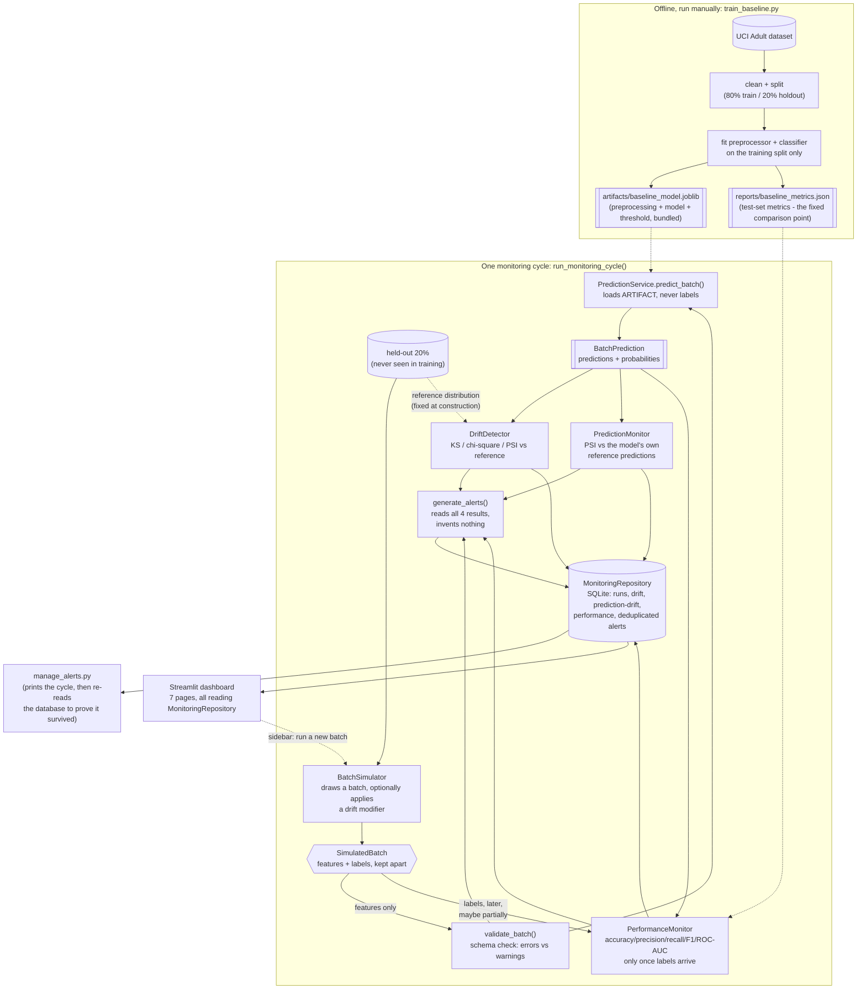

# System Architecture

How data actually flows through this project, end to end: validation,
preprocessing, inference, drift detection, prediction monitoring,
performance monitoring, alerting, persistence, and the dashboard. Every
component named here exists in `src/monitor/` and is covered by the test
suite - nothing below is aspirational.

## Two separate lifecycles

The project has two lifecycles that run at different times, by design, and
never share code paths that would let one quietly influence the other:

1. **Training** (`train_baseline.py`, run manually, offline) - fits the
   preprocessor and the classifier once, on the training split only, and
   saves them as a single artifact. This never runs automatically and is
   never triggered by anything in the monitoring path.
2. **Monitoring** (`manage_alerts.py`, or the dashboard's sidebar, run
   repeatedly, online) - loads that saved artifact and scores new batches
   against it, over and over, without ever touching the model's weights.

Keeping them separate is what makes the monitoring half honest: if the
model's weights could change in response to what the monitor sees, the
monitor would be grading a moving target.

## Diagram

## Stage by stage

### 1. Validation (`validation.py`)

Runs first, on raw incoming feature columns, before anything else touches
the batch. Checks two different kinds of problem and reports them at two
different severities:

- **Errors** - a required column is missing, or a column holds the wrong
  kind of value entirely (text where a number belongs). These block
  processing: `raise_if_invalid()` turns them into an exception.
- **Warnings** - missing values, an unknown category, a number outside the
  schema's plausibility bounds. These do not block processing; the model
  can still be scored safely (the preprocessor imputes missing values and
  encodes unknown categories as all-zero), but the finding is recorded.

Validation never modifies the data. It returns a `ValidationResult` the
caller decides what to do with.

### 2. Preprocessing and inference (`preprocessing.py`, `model.py`, `prediction.py`)

The saved artifact (`artifacts/baseline_model.joblib`) is a single
scikit-learn `Pipeline` with two steps: `preprocess` (imputing, scaling,
one-hot encoding - fitted once, during training, on the training split
only) and `classify` (a `LogisticRegression`, wrapped so that `.predict()`
applies the chosen decision threshold internally). Loading one file is
enough to go from a raw, Adult-shaped row to a prediction - there is no
separate preprocessing step elsewhere that could drift out of sync with
what the model expects.

`PredictionService.predict_batch` enforces one rule structurally, not just
by convention: it **raises** if the frame it receives still contains the
income column. At real prediction time that column does not exist yet;
letting it through, even accidentally, would make every later monitoring
step dishonest.

### 3. Data drift detection (`drift.py`)

Asks one question: *does this batch's input distribution look different
from the data the model was trained on?* Nothing here needs a label.

- **Numerical features** - a two-sample Kolmogorov-Smirnov test plus the
  Population Stability Index (PSI).
- **Categorical features** - a chi-square test plus PSI, with Cramér's V as
  an effect size.
- **The verdict is decided by PSI, not the p-value.** With tens of
  thousands of reference rows, a p-value becomes vanishingly small even for
  a trivial shift; PSI does not inflate with sample size the same way, so it
  is the more trustworthy signal for "does this matter," while the p-value
  is still reported for completeness.

See [`docs/drift_detection.md`](drift_detection.md) for the full method
descriptions, every threshold's provenance, and known limitations - this
architecture doc intentionally does not repeat that detail.

### 4. Prediction-distribution monitoring (`prediction_monitoring.py`)

Asks a related but different question: *has what the model is **saying**
changed?* Reuses `drift.py`'s exact PSI machinery, but compares the current
batch's predicted labels and predicted probabilities against the model's
own predictions on its training data (computed once, at startup, as the
reference). A model can start predicting more positives either because the
input genuinely shifted (which drift detection would also flag) or because
the model's own decision surface is behaving differently on inputs that
look unchanged on the input side - this stage catches the second case too.

### 5. Performance monitoring (`performance_monitoring.py`)

The only stage that needs **true labels**, and the only one answering the
question that actually matters in the end: *is the model still right?*
Predictions are registered immediately, with no label; labels are
submitted later, in any number of separate calls, matched by a stable
`batch_id:row_index` identifier so a label can never be confused for a
different row's. Three distinguishable outcomes, never fabricated:

| Labels available | `status` | What happens |
| --- | --- | --- |
| None yet | `no_labels` | `metrics=None` - genuinely nothing to report |
| Some, below the measured reliability floor | `insufficient_labels` | Metrics are computed and shown, flagged as an early signal |
| At or above the floor | `computed` | A metric comparison against the Phase-3 baseline, confidently reported |

### 6. Alert generation (`alerts.py`)

Reads the four results above - validation, drift, prediction drift,
performance - and decides what is worth a person's attention, at what
severity (INFO / WARNING / CRITICAL), in plain language. **Nothing here
recomputes a statistic.** The one rule most worth stating plainly: a
`no_labels` performance result can never produce a performance alert -
silence here means "we do not know yet," never "the model is fine."

### 7. Persistence (`storage.py`)

A single SQLite database (`monitoring/monitoring_history.db`) with six
tables: one row per run, one per batch summary, one per feature's drift
result, one per prediction-drift result, one per performance result, and
one per **distinct ongoing alert** - a recurring problem updates one row's
`occurrence_count` rather than ever flooding the table with duplicates.
Opening a connection per call keeps every operation its own transaction;
there is no shared state to go stale between calls, and the module is
tested with a throwaway database file and no model, dataset, or dashboard
involved at all.

### 8. The dashboard (`app.py`, `pages/`, `dashboard_common.py`)

Reads only from `MonitoringRepository` and calls the exact same
`run_monitoring_cycle` function the CLI script uses - the dashboard cannot
run the monitoring pipeline any differently than the command line does.
Seven pages: Overview, Data Quality, Data Drift, Prediction Monitoring,
Model Performance, Alerts, Monitoring History. See
[`docs/dashboard.md`](dashboard.md) for which pages survive a restart and
why, and [`docs/integration_testing.md`](integration_testing.md) for how
the real system (not a mock of it) was verified end to end.

## What this architecture deliberately does not do

- **No automatic retraining.** Drift and degraded performance are
  reported, never acted on. Deciding whether and how to retrain is a human
  decision this project does not make.
- **No feature store, message queue, or serving infrastructure.** Batches
  are drawn from a held-out split of a static dataset to simulate arrival;
  there is no real streaming source.
- **No authentication or multi-tenancy.** The dashboard and database are
  built for one operator exploring the system locally.
